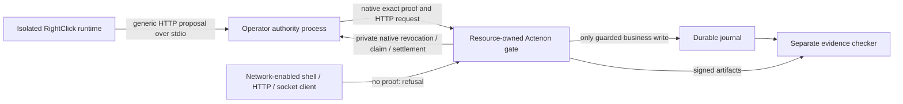

# Resource-owned exact-action enforcement

2026-10-18. **36/36 bounded development checks pass; programme PARTIAL, release NO-GO.** This implements the resource-owned case from the existing feasibility assessment on the same branch. It does not promote a fixture into an arbitrary-environment containment claim. [Preregistered plan](ACTENON-RESOURCE-PLAN.md), [final result](actenon/resource-attempt3/result.json), [raw checker result](actenon/resource-attempt3/raw-check.json).

## What changed

The disposable provider now owns its execution gate. Its HTTP service has one business-effect sink: a durable journal append called only through native `ActenonGate`. There is no separate raw backend HTTP listener. The service reconstructs the actual method, URL including Host/path/query, accepted semantic headers and exact body before verification. Duplicate/unknown headers and unsupported framing are refused. Explicit framing fields are excluded from semantic parameters; they do not affect this fixture's append semantics.

The provider receives the issuer's public verification key. A separate receipt key signs outcomes. Native Permit revocation, effect claim and settlement stay in a trusted authority process, reached through a private mode-0600 Unix socket. This solves the previous experiment's need to supply a grant HMAC secret directly to every edge worker without copying cryptography or introducing an Actenon dependency into RightClick X core. The IPC adapter transports native data and calls native APIs; it is an experiment adapter, not a released authority service.



Host supervisor, resource and authority processes are trusted and run as the same macOS user. The test proves no issuer secret was **supplied** through the resource's configuration/environment, not that a compromised same-user host process could never read it. The container principal has no issuer key, authority socket/store, journal mount or Docker socket. Production isolation between trusted services, authentication across hosts and credential vaults remain deployment work.

## Observations

- Public discovery starts with zero grants. It learns the normal OpenAPI operation but cannot write. After the operator installs a grant, a fresh contained runtime reuses the capability without rediscovery. Retained state contains no observed grant/proof IDs or proof headers.
- A separate container with working network access reads the same service's public document. Its direct HTTP, five unlisted/legacy-like routes, changed-method, shell and raw-socket requests reach the service and receive native `PCCB_REQUIRED` refusals. Duplicate Content-Length and Transfer-Encoding framing are rejected before parsing a proof. OS `lsof` independently observes only the protected resource TCP listener. Container inspection records the read-only script mount and unprivileged user.
- Post-issuance changes to method, path, query, body, semantic header and Host are refused. A forged signature is refused. **Validly signed** proofs for an unsupported effect profile and another audience are refused. The unchanged original proof remains usable once.
- Retained and generated RightClick routes cannot expand the operator's body bounds or issue/reconcile their own grants. A resource process restart preserves replay state. A revoked preissued proof and complete loss of the private authority service both refuse without effects.
- Exactly three labels appear once each: `approved`, `lost`, `proof-control`. The `lost` response closes after a durable append and native settlement; a fresh-proof retry is denied. Unlike a forwarding gateway that only sees an acknowledgement, this resource owns and fsyncs the actual effect. Its COMMITTED evidence is checked against the exact journal prefix hash for each append. RightClick still reports the HTTP result as semantically unverified without a separate outcome contract.
- A separate process verifies **24 native signed receipts and 21 signed refusals**, then rejects all **45 altered artifacts**. The raw checker additionally matches every native edge decision to a received HTTP request and every successful receipt/ledger entry to the journal. These are separate observation/implementation paths **by the same author**, not independent-author review or certification.

## Failures and reproducibility

| Attempt | Source freeze | Result |
|---|---|---|
| [1](actenon/resource-attempt1/failure.log) | `3b0dc042b756ed21d55d4fb1b7ca3759027a60c4` | Incomplete: test harness omitted native `PolicyDecision.rule_evaluations` when constructing the wrong-audience control. Raw earlier observations preserved; no pass claimed |
| [2](actenon/resource-attempt2/result.json) | `09388a176ead444daa0a7ccb7371b5ddf9b77910` | Self-reported 34/34, but the unsupported-profile proof also had an invalid signature. Does not establish profile-specific refusal; final checker rejects it |
| [3](actenon/resource-attempt3/result.json) | `e644702938c30fde5ae5b7f392dcd4b2afc6780f` | 36/36 with validly signed negative controls, live OS/container inspection and raw-artifact validation |

The checker's first draft expected ten proof-required requests although the prescribed workload has nine (direct + five aliases + changed method + shell + socket). Its source and failed output are preserved in attempt 3; the correction checks the exact route set and all actual requests. No case or acceptance criterion was removed. [Verification manifest](actenon/resource-verification.json) binds every artifact and source snapshot to the freezes.

Use the audited source installation and cached image described in [the experiment README](../../../experiments/actenon/README.md), from this evidence revision:

```sh
/absolute/audit-root/.venv/bin/python experiments/actenon/resource-experiment.py --output /absolute/new-resource-evidence
/absolute/audit-root/.venv/bin/python experiments/actenon/check-resource.py /absolute/new-resource-evidence
```

This harness was run on macOS with `/usr/sbin/lsof`, Python 3.12 and Docker Desktop's `host.docker.internal`, with Node in local Linux containers. It refuses an existing output directory or unaudited Actenon source, records the cached image identity, and cleans up its processes, containers and disposable private keys. It performs no model calls, remote provider effects, image pulls or paid operations.

## Readiness and commercial implication

The result supports the intended architectural split for this fixture: reusable discovery belongs to RightClick; exact execution authority belongs outside the agent and is enforced by the resource. Public reachability alone is no longer an unprotected route to the fixture's effect. It does not prove coverage of arbitrary legacy endpoints, other hosts, production services or a compromised trusted host.

The integration adds a native gate, private authority service, durable stores and key-role configuration. Per-dispatch revocation/claim/settlement IPC, receipt signing and fsync have real overhead; this experiment makes no latency or economic superiority claim. The stack is still source-pinned and ahead of published Actenon releases. A clean released install, lifecycle/economics comparison with equivalently protected direct/docs/skills baselines, full crash/outage/federation coverage, fresh holdouts, cross-vendor reuse and independent review remain required. Claude's preserved weekly-quota refusal still blocks the live development comparison. No commercial acceptance gate is promoted.
